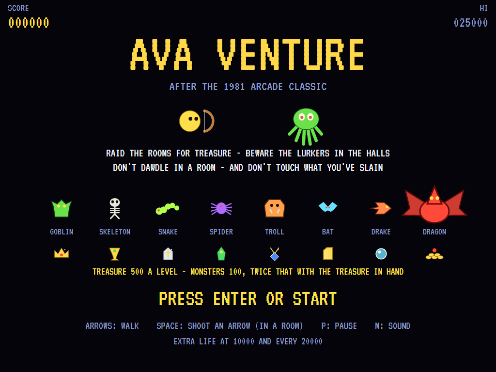
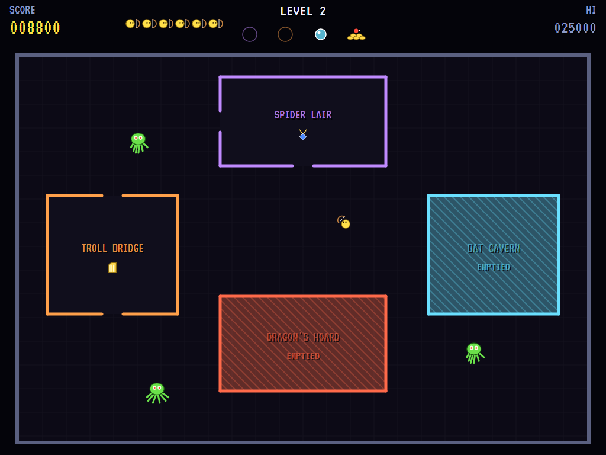
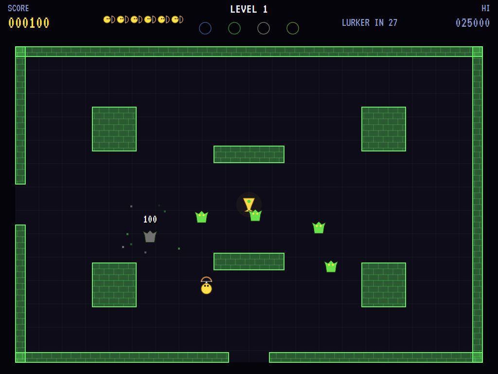
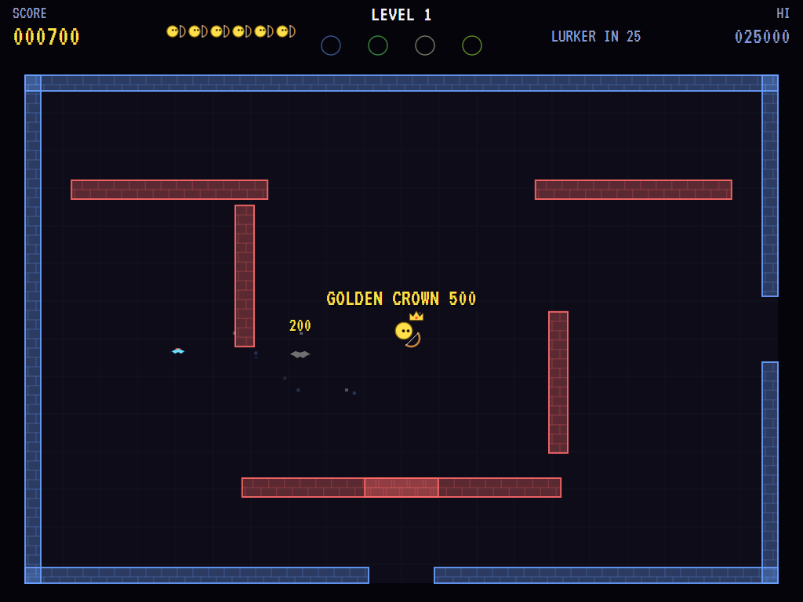
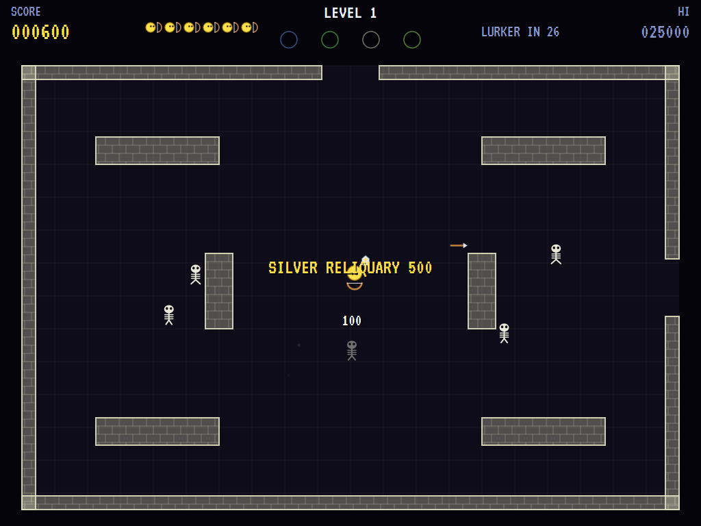
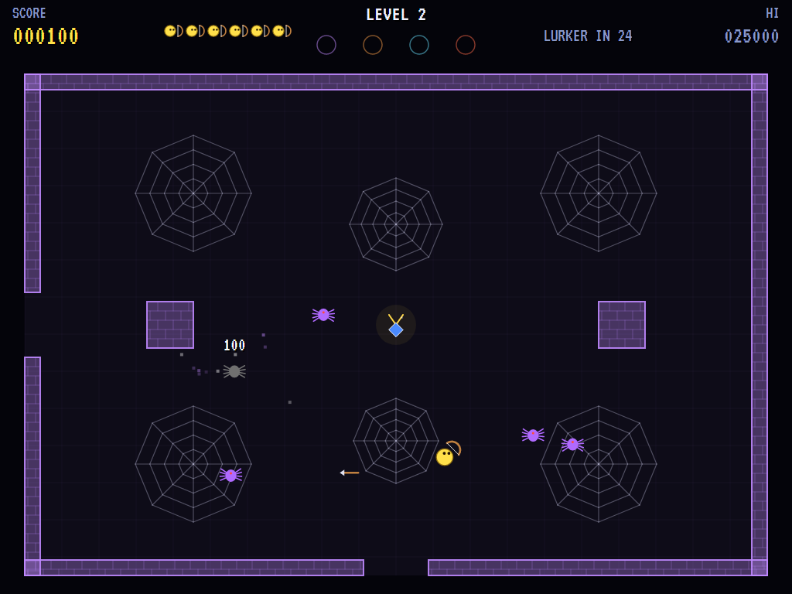
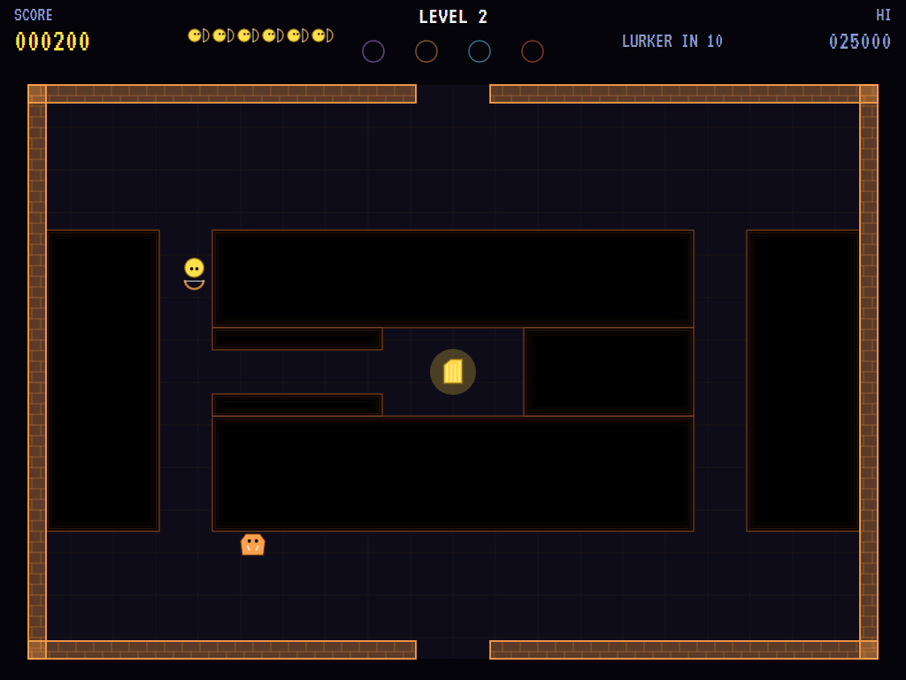
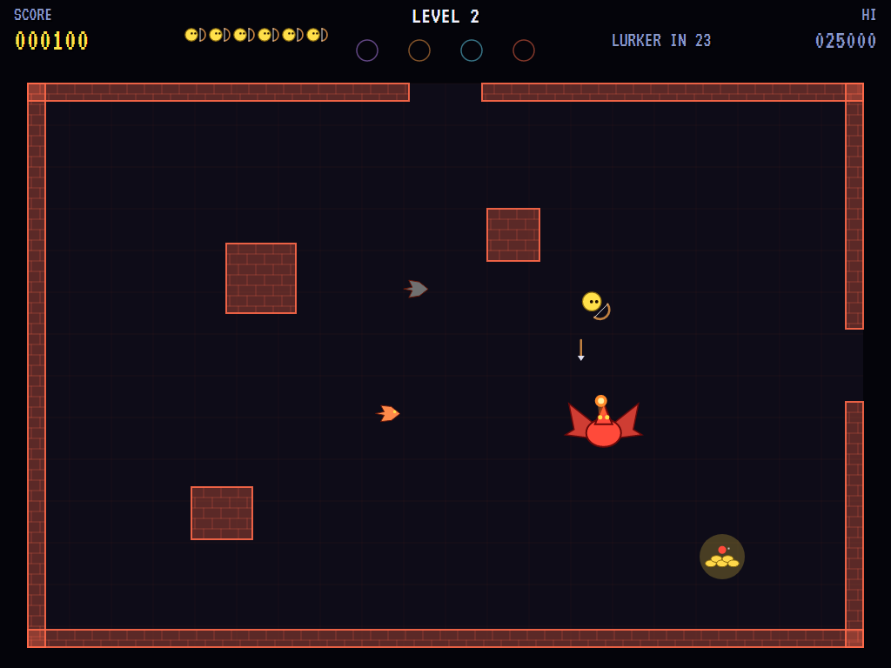
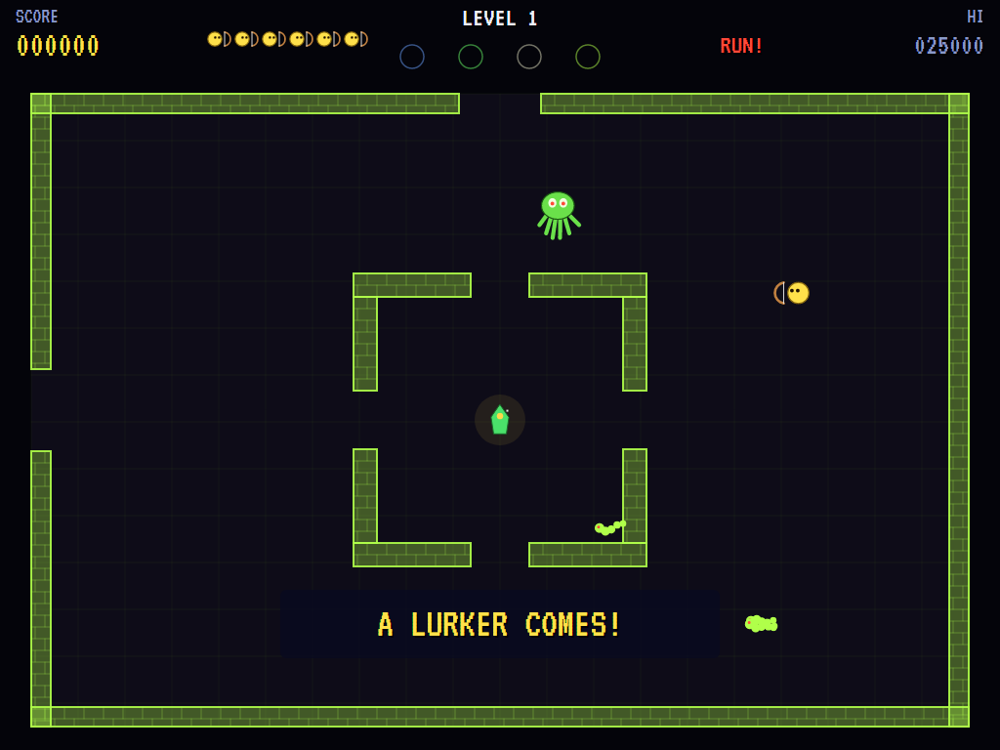
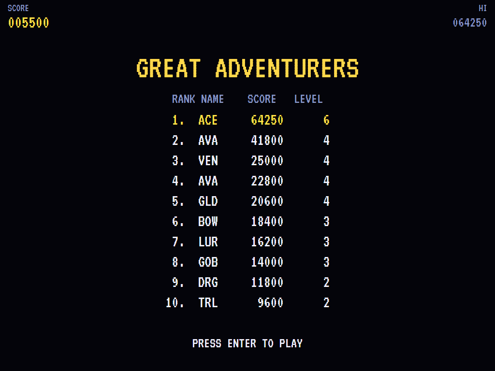

# AVA Venture

[](https://github.com/Harlock123/AVAVenture/actions/workflows/build.yml)

A dungeon raid in the style of Exidy's 1981 arcade game **Venture**, built with .NET 10 and Avalonia UI.
Each level of the dungeon is four rooms off a set of halls. Slip past the Lurkers in the halls, into each
room, and out again with its treasure. In the rooms your bow can bring down the monsters, but what you
slay stays deadly to touch until it fades. Don't dawdle, either: stay too long in a room and a Lurker
comes in after you.

## Features

- **The halls**:
  - **The map:** the level from above, its four rooms with their doorways, and the treasure waiting in each.
  - **The Lurkers:** green, many-legged things that drift after you through anything, walls and all. Nothing can hurt them; keep away.
  - **Emptied rooms** are filled in, and their doors are shut for good.
- **The rooms**: walk in through a doorway and the room fills the screen.
  - **Your bow:** an arrow flies the way you last moved, in any of the eight directions, one at a time. It stops at walls.
  - **Corpses:** a slain monster leaves its corpse behind, as deadly to touch as the monster was, until it fades.
  - **Treasure:** pick it up, and every monster you slay is then worth double. Leave with it and the room is emptied. Leave without it and it waits for you, with its monsters back.
  - **The Lurker:** stay too long and one comes in through the door you came by, quicker than the ones in the halls. The time it gives you is on the score bar, and it shortens each level.
- **The two levels' rooms**, round and round, quicker each time:
  - **The Shifting Hall:** walls that slide back and forth. Get caught between them and you're crushed.
  - **The Goblin Den:** goblins, and pillars to dodge round.
  - **The Bone Crypt:** skeletons among the coffins, quicker when you're near.
  - **The Serpent Pit:** snakes slithering at you through a broken ring of walls.
  - **The Spider Lair:** spiders that sit still, then dash; sticky webs slow you right down.
  - **The Troll Bridge:** a chasm crossed by narrow bridges, trolls on them, and the treasure on a ledge in the middle. Step off and you fall.
  - **The Bat Cavern:** bats flitting about among the stalagmites.
  - **The Dragon's Hoard:** drakes, and a dragon that lumbers after you breathing fire and takes several arrows to bring down.
- **Scoring**:

  | | Points |
  |---|---|
  | A monster | 100 (200 with the treasure in hand) |
  | The dragon | 1,000 (2,000) |
  | Each treasure | 500 times the level |
  | Clearing a level | 2,000 times the level |

  - **Extra lives** come at 10,000 and every 20,000 after that.
- **Sound**:
  - **The tunes:** an original jaunty adventure tune in A minor for the title, and a creeping dungeon theme as you go.
  - **The effects:** the bow's twang, arrows striking, monsters falling, the treasure's sparkle, the doors, the Lurker's growl, dragon fire, the walls closing, and the long fall.
  - All of it is synthesised and mixed by OpenAL.
- **Attract mode**: leave the title alone for 15 seconds and a computer adventurer plays. It finds its way across a grid, keeping well clear of Lurkers, monsters, corpses, chasms and sliding walls. It fetches each treasure, sidesteps dragon fire, and shoots anything lined up with its bow.
- **A top-ten high-score table** with arcade-style initials entry. It records the level reached.
- **Gamepads** through SDL2, as well as the keyboard.
- **Any window size**: the screen scales to fit, letterboxed. **Ctrl+S** saves a screenshot.
- **One self-contained executable** per platform: Windows, macOS and Linux on Intel/AMD and ARM.

## Screenshots

| The title | The halls | The Goblin Den |
|:---------:|:---------:|:--------------:|
|  |  |  |
| The monsters, and the eight treasures. | Two rooms emptied, Lurkers about. | A goblin slain, its corpse left behind. |

| The Shifting Hall | The Bone Crypt | The Spider Lair |
|:-----------------:|:--------------:|:---------------:|
|  |  |  |
| Walls that close in. | Out with the reliquary. | Webs to slow you down. |

| The Troll Bridge | The Dragon's Hoard | A Lurker comes |
|:----------------:|:------------------:|:--------------:|
|  |  |  |
| Don't step off. | Fire, and drakes. | Too long in the room. |

| The high scores | | |
|:---------------:|:-:|:-:|
|  | | |
| The great adventurers. | | |

The screenshots are made by the tests, which play the game in a real (headless) window; see
[Tests](#tests).

## Download and run

Ready-to-run builds for Windows, macOS and Linux, on both Intel/AMD and ARM, are on the
[Releases page](https://github.com/Harlock123/AVAVenture/releases/tag/latest). **Latest build** is
rebuilt on every push to `main`. Each download is one self-contained executable: no .NET install is
needed.

| Platform | Archive |
|---|---|
| Windows | `AVAVenture-win-x64.zip`, `AVAVenture-win-x86.zip`, `AVAVenture-win-arm64.zip` |
| macOS | `AVAVenture-osx-arm64.tar.gz` (Apple silicon), `AVAVenture-osx-x64.tar.gz` (Intel) |
| Linux | `AVAVenture-linux-x64.tar.gz`, `AVAVenture-linux-arm64.tar.gz`, `AVAVenture-linux-arm.tar.gz` |

```bash
tar -xzf AVAVenture-linux-x64.tar.gz     # or linux-arm64, linux-arm, osx-arm64, osx-x64
./AVAVenture
```

On Windows, unzip and run `AVAVenture.exe`. On macOS, if Gatekeeper refuses to open it, run
`xattr -d com.apple.quarantine AVAVenture` once. Run with `--no-audio` for silence.

**Sound** comes through OpenAL Soft, built in for every platform. In a virtual machine the game
detects it and uses a larger audio buffer, so the sound doesn't break up.

**Gamepads** use SDL2, which is bundled for Windows, macOS and Intel/AMD Linux. ARM Linux builds need it
installed; without it the keyboard still works:

```bash
sudo apt install libsdl2-dev            # Debian / Ubuntu / Raspberry Pi OS
sudo pacman -S --needed sdl2-compat     # Arch / Omarchy
```

## Controls

| Input | Action |
|-------|--------|
| **Enter** | Start |
| **Arrow keys** / **W A S D** | Walk (diagonals too) |
| **Space** / **Z** / **X** / **Ctrl** | Shoot an arrow, the way you last walked (in a room) |
| **P** / **Esc** | Pause (Esc again to quit) |
| **M** | Mute |
| **Ctrl+S** / **Cmd+S** | Save a screenshot to the Pictures folder |

**Gamepad**: left stick or D-pad to walk, **A**, **B**, **X** or the right trigger to shoot, **Start** to
start and pause, **Back** (while paused) to quit.

**Entering initials**: type letters, or dial with **Up**/**Down** and accept with **Space**; **Left** /
**Backspace** go back; **Enter** finishes.

## Tests

```bash
dotnet test AVAVenture.slnx
```

The engine has no UI and runs in fixed 60 Hz steps, so it plays the same at any frame rate, and a seed
always plays the same game. The tests check:

- **The halls:**
  - walking, and the walls
  - Lurkers drifting through anything, and catching the adventurer
  - through a doorway into a room
- **The rooms:**
  - arrows flying the way the adventurer faces, one at a time
  - corpses, deadly and fading
  - double points with the treasure
  - out with the treasure (the room shut for good) and without it
  - the Lurker coming in after a dawdler
  - sliding walls, webs and the chasm
  - the dragon's fire and its toughness
- **Losing and levels:**
  - back to the start
  - the last life
  - the level bonus and the next map
  - every room enterable and leavable by every door
  - extra lives
- **The machine:** the attract cycle, the computer adventurer clearing the first level, the same game from the same seed, and pausing

The screenshot tests draw the real screen in a headless window. To refresh the README's pictures:

```bash
VENTURE_SHOTS=$PWD/Images dotnet test tests/AVAVenture.Tests --filter ScreenshotTests
```

To see how the computer adventurer gets on, level by level (for tuning):

```bash
VENTURE_PROBE=1 dotnet test tests/AVAVenture.Tests --filter PilotProbe --logger "console;verbosity=detailed"
```

## Building

```bash
dotnet build AVAVenture.slnx
dotnet run --project src/AVAVenture
```

Needs the .NET 10 SDK. The sounds are made by `tools/make_sounds.py` (standard-library Python):
`python3 tools/make_sounds.py` rewrites `src/AVAVenture/Sounds`.

## Project structure

```
AVAVenture/
├── AVAVenture.slnx
├── src/AVAVenture/
│   ├── Engine/
│   │   ├── GameEngine.cs        # States, the title and demo cycle, and the dungeon music
│   │   ├── GameEngine.Play.cs   # The halls and the Lurkers; the rooms, their monsters, arrows,
│   │   │                        # corpses, fire, sliding walls and chasms; levels and scoring
│   │   ├── ShipPilot.cs         # The computer adventurer, for the demonstration (and the tests)
│   │   ├── Entities.cs          # The two levels' maps and all eight rooms, and the things in them
│   │   ├── HighScoreTable.cs, InitialsEntry.cs
│   │   ├── InputHandler.cs, ControllerManager.cs  # Keys and an SDL2 gamepad
│   │   └── SoundManager.cs      # Effects and the tunes through OpenAL
│   ├── Audio/                   # The OpenAL engine (from the author's AVABand)
│   ├── Views/                   # The halls, the rooms, the hero, the monsters and the screens
│   └── Sounds/                  # The synthesised effects and tunes
├── tests/AVAVenture.Tests/      # Gameplay, screenshot and probe tests
├── tools/make_sounds.py
└── Images/                      # Screenshots
```

## About and licence

AVA Venture © 2026 Lonnie Watson, under the [MIT License](LICENSE).

*Venture* © 1981 Exidy; the name belongs to its current owner. AVA Venture is an independent, unofficial
game in its style. Its adventurer, its Lurkers, its rooms, monsters and treasures, its graphics, sounds,
tunes and code are its own; nothing is taken from the arcade machine's program, graphics, sound or
music. It is not affiliated with or endorsed by any rights holder.
